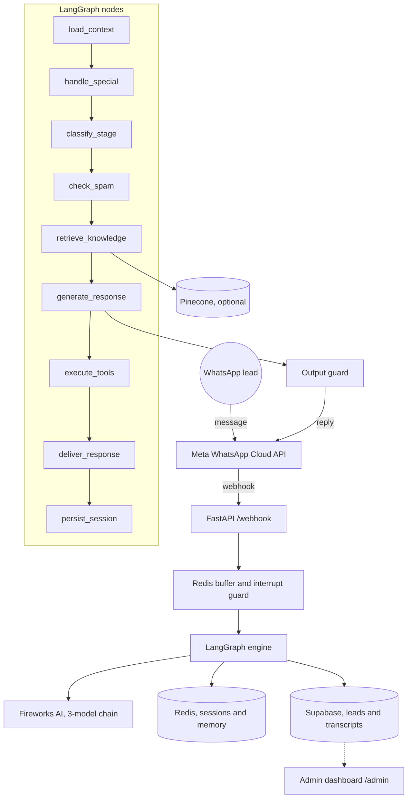

<div align="center">


# Mark, AI SDR for WhatsApp

**A human-sounding sales rep that qualifies inbound WhatsApp leads and books them onto discovery calls, around the clock.**

[](https://www.python.org/)
[](https://fastapi.tiangolo.com/)
[](https://langchain-ai.github.io/langgraph/)
[](https://developers.facebook.com/docs/whatsapp/cloud-api/)
[](https://fireworks.ai/)
[](https://render.com/)
[](LICENSE)

</div>

---

## Table of contents

- [About the project](#about-the-project)
- [Features](#features)
- [How it works](#how-it-works)
- [How to install and run](#how-to-install-and-run)
- [How to use](#how-to-use)
- [Configuration flags](#configuration-flags)
- [Tests](#tests)
- [Roadmap](#roadmap)
- [How to contribute](#how-to-contribute)
- [Credits](#credits)
- [License](#license)

---

## About the project

### The problem

A business that runs ads or a contact form gets leads at all hours. Most of those leads go cold because nobody replies within the first few minutes, and sales reps spend their day asking the same qualifying questions again and again.

### What Mark does

Mark is an AI sales development rep (SDR) that lives on a WhatsApp business number. When a new lead fills in a form or sends a message, Mark:

1. Replies in a natural, human way, with read receipts, typing pauses and short message bubbles.
2. Asks qualifying questions and scores the lead on Budget, Authority, Need and Timeline (BANT).
3. Answers factual questions from a real knowledge base instead of guessing.
4. Offers call times and sends the booking link when the lead is ready.
5. Hands the conversation to a human rep when it should.

Everything Mark does is logged to Supabase, so the team can follow each lead in the admin dashboard.

### Why these technologies

| Choice | Reason |
|---|---|
| Official Meta WhatsApp Cloud API | The supported, ban-safe way to run a business number. No reverse-engineered libraries. |
| FastAPI | Fast async Python web server for the webhook and admin endpoints. |
| LangGraph | Splits each reply into small, testable steps instead of one large prompt call. |
| Fireworks AI | One provider with three models in a fail-fast chain, so a slow model never stalls a reply. |
| Redis | Buffers rapid messages and holds live session state and lead memory. |
| Supabase | Stores clients, leads, transcripts and training data, and powers the dashboard. |
| Pinecone (optional) | Retrieval grounding with built-in embeddings, so factual answers come from the knowledge base. |

### Challenges

- **Long threads:** a simple summary made Mark "forget" facts after 30 or more messages. A structured per-lead memory fixed this (see [ADR 0003](docs/adr/0003-structured-conversation-memory.md)).
- **Prompt size:** one 41,000 character prompt was sent on every reply. A layered prompt, built per turn, cut input tokens by about 60% (see [ADR 0001](docs/adr/0001-layered-context-architecture.md)).
- **Slow model calls:** SDK retries on the same slow model once stacked one reply to 77 seconds. Retries are now off, and Mark moves to the next model instead.
- **Made-up claims:** instructions alone did not stop the model from inventing claims. A code-level output filter now removes banned claims, dashes and emojis before every send (see [ADR 0004](docs/adr/0004-grounding-and-hallucination-filter.md)).

---

## Features

- **Official WhatsApp Cloud API only.** Earlier Baileys and OpenWA providers were removed.
- **Human behavior layer.** Blue ticks, reading delay, think pause, typing indicator and a gap between message bubbles. A new message from the lead interrupts typing.
- **Message buffer.** Waits for 5 seconds of silence (8 seconds at most) so several quick messages get one reply.
- **Fireworks model chain.** Primary, secondary and fallback models, with no retries on a slow model.
- **Layered context.** The system prompt is assembled per turn from soul, facts, playbook and style layers, plus knowledge only when it is relevant.
- **Structured lead memory.** Company, pains, objections and booking status are kept for each lead.
- **Retrieval grounding.** Optional Pinecone index loaded from the `prompts/` knowledge files.
- **Output guard.** Deterministic filter for banned claims, em dashes and emojis.
- **BANT scoring.** Runs in the background and decides when Mark pushes for a booking.
- **Voice notes.** WhatsApp voice notes are transcribed with OpenAI Whisper (needs `OPENAI_API_KEY`).
- **Cal.com booking.** Sends the booking link and receives booking events on `/calcom-webhook`.
- **Multi-client.** Each business (client) has its own settings and prompt in Supabase.
- **Admin dashboard.** A React app served by the backend at `/admin`, with overview, leads, conversations, bookings, agent performance, instances and training pages.
- **Training data export.** Finished conversations can be labelled and exported for model training.
- **Flag-gated changes.** Each new capability turns on or off with an environment variable.

---

## How it works



1. A lead messages the business number, or a form sends the lead to `/form-webhook`.
2. Meta calls `/webhook`. Mark checks the signature when `WHATSAPP_APP_SECRET` is set.
3. Redis buffers quick messages into one turn.
4. LangGraph loads the lead's context, handles special cases, classifies the sales stage, checks for spam and, if needed, retrieves knowledge.
5. Fireworks AI writes the reply. The output guard cleans it.
6. Mark sends the reply with human-like timing and saves the session, memory and BANT signals.

| Part | Folder or file |
|---|---|
| LangGraph graph and nodes | `app/graph/` |
| Layered prompt files | `prompts/layers/` |
| Prompt assembly | `app/context_assembler.py` |
| Lead memory | `app/lead_memory.py` |
| Knowledge retrieval | `app/knowledge.py` |
| Output guard | `app/output_guard.py` |
| BANT scoring | `app/bant.py` |
| Human timing | `app/human_behavior.py` |
| Model chain | `app/llm_router.py` |
| Database tables | `supabase/migrations/` |
| Admin dashboard (React) | `mark-agent-front/` |
| Design decisions | `docs/adr/` |

---

## How to install and run

### What you need

| Service | Used for | Settings (names only) |
|---|---|---|
| Meta WhatsApp Cloud API | Send and receive messages | `WHATSAPP_PHONE_NUMBER_ID`, `WHATSAPP_ACCESS_TOKEN`, `WHATSAPP_BUSINESS_ACCOUNT_ID`, `WHATSAPP_VERIFY_TOKEN`, `WHATSAPP_APP_SECRET`, `WHATSAPP_API_VERSION` |
| Fireworks AI | Writes the replies | `FIREWORKS_API_KEY` |
| Redis or Upstash | Buffer, sessions and memory | `REDIS_URL`, or `UPSTASH_REDIS_REST_URL` and `UPSTASH_REDIS_REST_TOKEN` |
| Supabase | Clients, leads, transcripts | `SUPABASE_URL`, `SUPABASE_KEY`, `SUPABASE_SERVICE_KEY` |
| Cal.com | Booking link | `CALCOM_LINK` |
| Pinecone (optional) | Knowledge grounding | `PINECONE_API_KEY` |
| OpenAI (optional) | Voice note transcription | `OPENAI_API_KEY` |
| Sentry (optional) | Error tracking | `SENTRY_DSN` |
| Mark itself | Protects the outbound and debug endpoints | `OUTBOUND_API_KEY`, `ALLOWED_ORIGINS` |

You also need Python 3.11, and Node.js 20 if you want to build the dashboard yourself.

### Steps

1. Clone the repo and open the folder.

   ```bash
   git clone https://github.com/niihhhall/mark.ai.git
   cd mark.ai
   ```

2. Make a virtual environment and install the packages.

   ```bash
   python -m venv .venv
   # Windows PowerShell: .\.venv\Scripts\Activate.ps1
   # macOS or Linux:      source .venv/bin/activate
   python -m pip install -r requirements.txt
   ```

3. Copy `.env.example` to `.env` and fill in the settings from the table above. Never commit `.env`.

4. Create the database tables by running the SQL files in `supabase/migrations/` in number order in your Supabase project.

5. Start the backend.

   ```bash
   uvicorn main:app --port 8000
   ```

   Check that it runs: `http://localhost:8000/health` returns `{"status": "ok"}`.

6. Connect the Meta webhook. In your Meta app, set the webhook URL to `https://<your-host>/webhook`, use the same verify token as `WHATSAPP_VERIFY_TOKEN`, and subscribe to the `messages` field. Then subscribe the app to your WhatsApp Business Account (`POST /{WABA_ID}/subscribed_apps`).

7. Optional: load the knowledge base into Pinecone. This reads `prompts/layers/knowledge.md`, `prompts/knowledge/` and `prompts/objections/`. Run it again after each knowledge change; it is safe to repeat.

   ```bash
   python scripts/ingest_kb.py
   ```

8. Optional: push `prompts/system_prompt.txt` into a client's prompt in Supabase.

   ```bash
   python scripts/sync_prompt.py              # default client
   python scripts/sync_prompt.py <client_id>  # one client
   ```

### Run with Docker

The `Dockerfile` builds the dashboard in a Node.js stage, then runs the Python backend on port 8000.

```bash
docker build -t mark .
docker run --env-file .env -p 8000:8000 mark
```

### Deploy

Production runs on [Render](https://render.com/) as a Docker web service, set up in `render.yaml`. A push to `main` starts a new deploy. Commits that only change docs can include `[skip render]` in the message to skip the deploy. Secrets are set in the Render dashboard, never in `render.yaml`.

---

## How to use

### Admin dashboard

Open `/admin` on your host. The first time, the dashboard asks for your Supabase project URL and anon key to connect to your workspace. To work on the dashboard itself:

```bash
cd mark-agent-front
npm ci
npm run dev
```

### Send a lead to Mark

Mark sends the first message to a new lead from a form or a script. These endpoints need the `X-API-Key` header with your `OUTBOUND_API_KEY`.

```bash
curl -X POST https://<your-host>/form-webhook \
  -H "Content-Type: application/json" \
  -H "X-API-Key: <OUTBOUND_API_KEY>" \
  -d '{"first_name": "Sam", "phone": "+15550000000", "company": "Acme"}'
```

| Endpoint | What it does |
|---|---|
| `POST /form-webhook` | Starts outreach from a website or n8n form (`first_name` or `name`, `phone`, optional `company` and `client_id`). |
| `POST /send-outbound` | Starts outreach from a JSON body with `name`, `phone` and `company`. |
| `POST /follow-up` | Sends the follow-up message to a lead (`lead_id`, `name`, `phone`). |

The first message to a new lead must use an approved Meta message template. Free-form messages are allowed only inside the 24-hour window that opens when the lead replies.

### Actions Mark can take

Mark adds these tags to the end of a reply. The tags are removed before the lead sees the message.

| Tag | Action |
|---|---|
| `[SEND_BOOKING_POLL]` | Offers call times in a clickable poll. |
| `[SEND_CALENDLY]` | Sends the Cal.com booking link (the tag keeps its old name). Only when the lead asks or agrees. |
| `[SEND_PRICING]` | Sends the pricing overview. |
| `[ESCALATE]` | Hands the conversation to a human rep. |

### Checks and diagnostics

| Endpoint | What it shows | Key needed |
|---|---|---|
| `GET /health` | The service is up. | No |
| `GET /metrics` | Uptime, message count and LLM usage. | No |
| `GET /debug/prompt-source` | Which prompt source is live and which flags are on. | Yes, `X-API-Key` |
| `GET /debug/memory/{phone}` | The stored memory for one lead. | Yes, `X-API-Key` |

The debug endpoints stay off when `OUTBOUND_API_KEY` is not set.

---

## Configuration flags

Each flag is an environment variable, so you can turn a capability on or off in Render (or `.env`) without a code change.

| Flag | Default in code | Purpose |
|---|---|---|
| `MESSAGING_PROVIDER` | `whatsapp_cloud` | Messaging channel. `whatsapp_cloud` is the only supported value. |
| `USE_LAYERED_CONTEXT` | `true` | Layered prompt assembly ([ADR 0001](docs/adr/0001-layered-context-architecture.md)). |
| `USE_STRUCTURED_MEMORY` | `false` | Structured per-lead memory ([ADR 0003](docs/adr/0003-structured-conversation-memory.md)). |
| `USE_PINECONE_GROUNDING` | `false` | Pinecone retrieval grounding ([ADR 0004](docs/adr/0004-grounding-and-hallucination-filter.md)). |
| `ENABLE_CLAIM_FILTER` | `true` | Banned-claims output filter ([ADR 0004](docs/adr/0004-grounding-and-hallucination-filter.md)). |
| `MAX_CONTEXT_MESSAGES` | `35` | Recent messages sent to the model per reply. |
| `INPUT_BUFFER_SECONDS` | `5.0` | Silence to wait for before Mark replies. |
| `INPUT_BUFFER_MAX_SECONDS` | `8.0` | Longest wait before Mark replies. |

### Measured results

| Change | Before | After | Result |
|---|---|---|---|
| Prompt assembly | One prompt of about 41,000 characters on every reply | Layered, about 16,000 characters, knowledge only when relevant | About 60% fewer input tokens (about 10.3k to 4.7k per reply) |
| LLM providers | 4 providers, a model-override bug caused 404 errors | Fireworks only, 3-model fail-fast chain | Fewer failures, simpler setup |
| Slow calls | The SDK retried the same slow model (one call took 77 seconds) | `max_retries=0`, then the next model | No more minute-long stalls |
| Long threads | A summary that lost facts | Structured lead memory in its own Redis key | Facts kept across 30 to 40 messages |
| Context window | Last 10 messages | Configurable, default 35 | More recent context |

---

## Tests

The tests in `tests/` check the rules Mark must follow: no dashes or emojis, no banned claims, safe memory merges, message buffering and chunking, phone number handling, the state machine, templates, the webhook and the WhatsApp Cloud client. They run offline and do not send real messages.

```bash
python -m pytest tests -q
```

Decision records for the test harness are in [ADR 0002](docs/adr/0002-agent-harness-and-eval.md).

---

## Roadmap

- [x] LangGraph conversation engine
- [x] Move to the official Meta WhatsApp Cloud API
- [x] Fireworks-only model chain with fail-fast fallback
- [x] Layered context (ADR 0001)
- [x] Test harness (ADR 0002)
- [x] Structured conversation memory (ADR 0003)
- [x] Pinecone grounding and output filter (ADR 0004)
- [x] Admin dashboard served from the backend
- [x] Hosting on Render
- [ ] Long-term memory across conversations
- [ ] Real-time voice-to-voice calls

---

## How to contribute

Please open an issue before you start work, so we can agree on the change first.

- Read [CONTRIBUTING.md](CONTRIBUTING.md) for setup, tests and the pull request flow.
- Follow the [Code of Conduct](CODE_OF_CONDUCT.md).
- Report security problems privately as described in [SECURITY.md](SECURITY.md). Do not open a public issue for them.
- See [CHANGELOG.md](CHANGELOG.md) for what changed in each version.

---

## Credits

- Built by the Markeye team, [markeye.space](https://markeye.space).
- README structure based on [How to Write a Good README File for Your GitHub Project](https://www.freecodecamp.org/news/how-to-write-a-good-readme-file/) by Hillary Nyakundi on freeCodeCamp.
- [Contributor Covenant](https://www.contributor-covenant.org/) for the Code of Conduct.
- [Keep a Changelog](https://keepachangelog.com/) for the changelog format.
- Badges from [shields.io](https://shields.io/).
- Built with [FastAPI](https://fastapi.tiangolo.com/), [LangGraph](https://langchain-ai.github.io/langgraph/), [Fireworks AI](https://fireworks.ai/), the [Meta WhatsApp Cloud API](https://developers.facebook.com/docs/whatsapp/cloud-api/), [Supabase](https://supabase.com/), [Redis](https://redis.io/), [Pinecone](https://www.pinecone.io/), [Cal.com](https://cal.com/), [React](https://react.dev/) and [Vite](https://vite.dev/).

---

## License

Copyright (c) 2026 Nihal Mishra. All rights reserved.

This code is not open source. You may view it on GitHub, but you may not use, copy, change, share or sell it without written permission. See [LICENSE](LICENSE) for the full terms.
